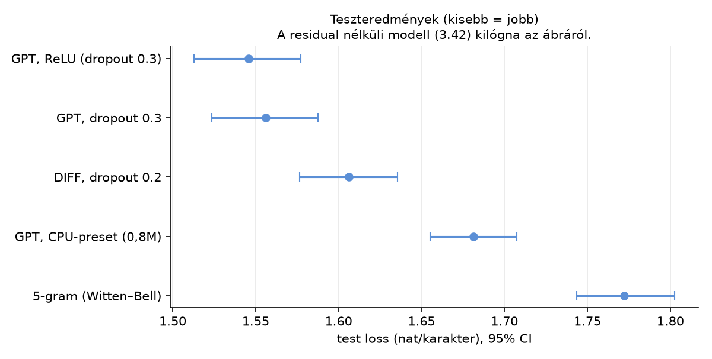
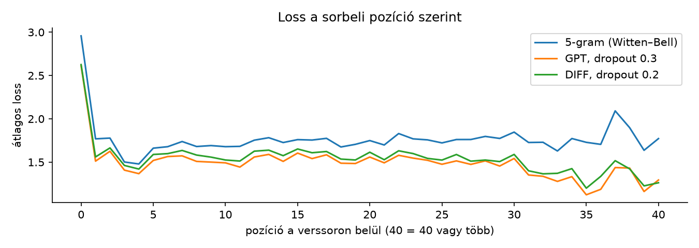
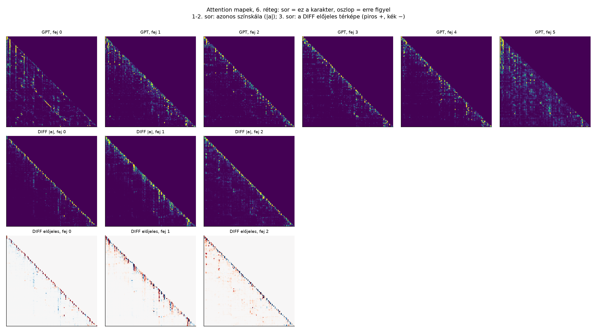
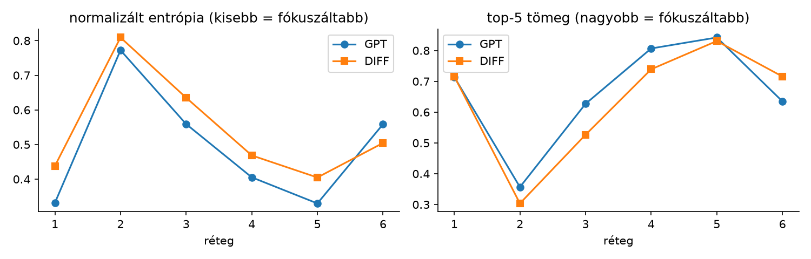
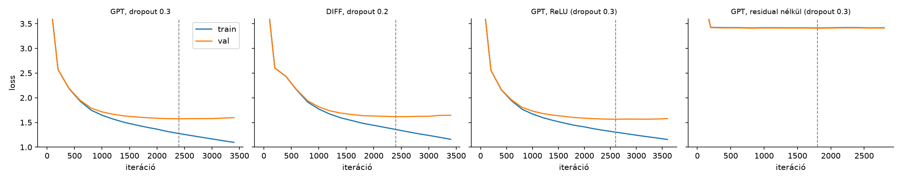
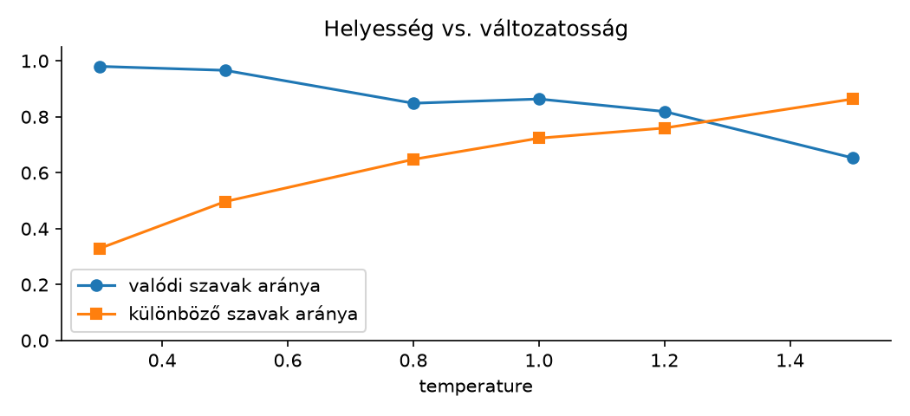
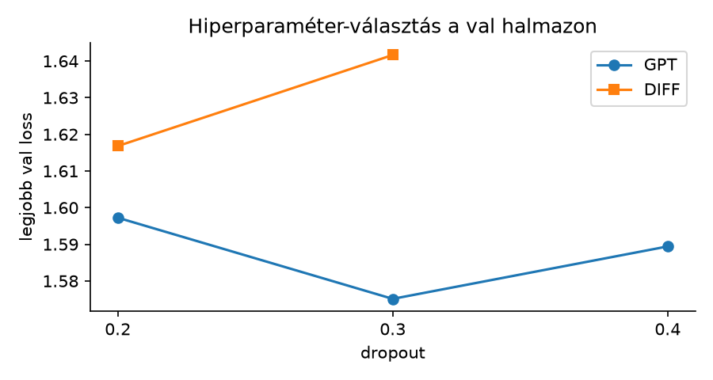
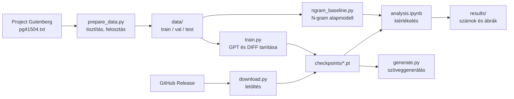

# Petőfi-GPT

Karakter-szintű GPT nyelvi modell, nulláról megírva PyTorch-ban, Petőfi Sándor verseire tanítva. A projekt összeveti egy klasszikus N-gram modellel és a Differential Transformer változattal, ablation-kísérletekkel pedig megnézi, mennyit számítanak a modell egyes részei.

*Nagy nyelvi modellek (MSc) – féléves projekt. English summary: [lent](#english-summary).*

Részlet a végleges modell által generált szövegből (temperature 0,8):

```text
Mit beszélek: »Homlokány a hirtelen élet!«
Mit beszéltem, mint a ti jó szép alak,
Ki beszéltém alutt, hogy ne megyek,
A ki nem maradjon meg, mint a hegyre?
```

A modell betűről betűre ír, és senki nem tanította meg neki a szavakat, a sorokat vagy a régi helyesírást: mindezt a versekből tanulta meg.

---

## Gyors teszt (kb. 5 perc, GPU nélkül)

Ha csak ki szeretnéd próbálni a modellt. A teljes reprodukálás (adat, tanítás, elemzés) a [Futtatás](#futtatás) részben van.

```bash
git clone https://github.com/janosibenedek/petofi-gpt.git
cd petofi-gpt
pip install torch --index-url https://download.pytorch.org/whl/cpu   # PyTorch CPU-s változata (kisebb letöltés)
pip install -r requirements.txt

python model.py              # a modell öntesztje
python download.py --quick   # a kis modell letöltése (cpu.pt, 3 MB)
python generate.py --checkpoint checkpoints/cpu.pt --prompt "Szabadság, szerelem!\n"
```

Ugyanez a végleges, nagy modellel:

```bash
python download.py --final   # a két végleges modell (2 × 43 MB)
python generate.py --checkpoint checkpoints/colab_drop03.pt --prompt "Szabadság, szerelem!\n"
```

Ajánlott Python 3.12, külön környezetben (lásd [Futtatás](#futtatás)).

---

## Eredmények

| Modell | Paraméter | Test loss ↓ | 95% CI | Perplexity ↓ |
|---|---:|---:|:---:|---:|
| **GPT** (végleges, dropout 0,3) | 10,8 M | **1,556** | [1,523; 1,588] | **4,74** |
| GPT, ReLU aktivációval | 10,8 M | 1,546 | [1,513; 1,577] | 4,69 |
| Differential Transformer (dropout 0,2) | 10,8 M | 1,606 | [1,576; 1,635] | 4,98 |
| kis GPT (CPU-n tanítva) | 0,8 M | 1,681 | [1,655; 1,707] | 5,37 |
| 5-gram (Witten–Bell simítás) | – | 1,772 | [1,744; 1,803] | 5,88 |
| GPT residual kapcsolat nélkül | 10,8 M | 3,423 | [3,411; 3,436] | 30,65 |

**Hogyan olvassuk?**

- **Test loss:** átlagosan mennyire „lepődik meg” a modell a következő karakteren (−ln p, nat/karakter). Kisebb = jobb.
- **Perplexity** (= e^loss): mintha a modell minden karakternél átlagosan ennyi lehetőség között bizonytalankodna. A végleges GPT kb. 5 lehetőség közül választ, a vak találgatás 97 közül.
- **95% CI:** ebben a sávban mozog az eredmény, ha a teszt verseit újrasorsoljuk (bootstrap a 117 test-versen).



### 1. Jobb-e a GPT egy klasszikus N-gram modellnél?

**Igen, egyértelműen:** 4,74 vs. 5,88 perplexity, és a 117 test-versből 116-ban a GPT a jobb. A legtöbbet **a sorok elején** nyer. Ott az előző sorok ismerete kell (versszerkezet, ritmus), az 5-gram viszont csak az utolsó 4 karaktert látja, a GPT 256-ot.



*Átlagos loss a verssoron belüli pozíció szerint. A 0. pozíció a sor első karaktere: itt a legnehezebb jósolni.*

### 2. Segít-e a Differential Transformer?

**Ezen a méreten nem.** A Differential Transformer (DIFF) a figyelmet két figyelmi térkép különbségeként számolja, hogy kioltsa a lényegtelen pozíciókra jutó „zajt”. Nálunk mégis rosszabb lett a sima GPT-nél (4,98 vs. 4,74; a GPT 111/117 versben jobb), és a figyelme sem lett fókuszáltabb. A cikk az előnyt sokkal nagyobb modelleken és hosszú szövegeken mutatta ki, ahol sok a kioltandó zaj. Egy 10 milliós, 256 karakteres kontextusú modellnél ez nem jött elő.



*Az utolsó réteg figyelme egy test-versszakon. Minden kis kép egy figyelmi fej: a sor az aktuális karakter, az oszlop az a korábbi karakter, amelyikre figyel; világosabb = erősebb figyelem. Felül a GPT 6 feje, középen a DIFF 3 feje, alul a DIFF előjeles térképe (piros: pozitív, kék: negatív figyelem, vagyis amit a modell kivon).*



*Mennyire fókuszált a figyelem rétegenként. Ha a DIFF fókuszáltabb lenne, a narancs vonal a bal ábrán lejjebb, a jobb ábrán feljebb lenne. Ez csak az utolsó rétegben teljesül.*

### 3. Mennyit számítanak a modell részei? (ablation)

- **Residual kapcsolat nélkül a modell nem tanul:** megreked a betűgyakoriság szintjén (perplexity ~30). Mély hálózatban a residual kapcsolat viszi át a jelet és a gradienst a rétegeken.
- **ReLU vs. GELU:** a ReLU-s változat egy hajszállal jobb (kb. 0,65%), de ez egyetlen tanításból jön, ezért a kettőt gyakorlatilag egyenértékűnek tekintjük.
- **Méret:** a 10,8 milliós modell mind a 117 versben jobb a 0,8 milliósnál. A kis modell tanítása viszont a lépéskeret végén állt le (lásd [Korlátok](#korlátok)), így ez a különbség részben a tanítás hosszából is adódik.



*Tanulási görbék. A szaggatott vonal az a lépés, ahol a val loss a legkisebb volt: ezt a modellt tartottuk meg (early stopping). Utána a train loss tovább csökken, a val loss nem, vagyis a modell innen már túltanulna. Jobb szélen a residual nélküli modell, amely az első esés után megakad.*

### 4. Hogyan hat a temperature és a top-k a generált szövegre?

Alacsony temperature-nél a szöveg helyes, de **ismétlődik**, magasnál változatos, de egyre több benne a **nem létező szó**. Jó egyensúly 0,8–1,0 körül van.

| temperature 0,3 | temperature 1,5 |
|---|---|
| Mi a magyar nép, mi a magyar nép!<br>Nem a magyar nép, ha meghalni,<br>Magyar nép, meghalni a magyar nép! | Értő fogadást dörfelhőket,<br>Pillangott szavának,<br>Útazólag leveledtek őket, |



*Valódi szavak aránya: a generált szavak hány százaléka fordul elő a tanítószövegben. Különböző szavak aránya: mennyire változatos a szöveg (alacsony = ismétlés).*

A top-k hasonlóan hat: top-k = 1-nél (mindig a legvalószínűbb karakter) minden szó valódi, de csak kb. 5%-uk különböző, mert a modell körbe-körbe ismétel.

---

## Hogyan dolgoztunk?

- **Adat:** *Petőfi Sándor összes költeményei* ([Project Gutenberg #41504](https://www.gutenberg.org/ebooks/41504)). Tisztítás után 811 vers, 97 különböző karakter. A felosztás versenként történik, így egy vers sosem kerül két halmazba: train 579 vers (774 ezer karakter), val 115 (97 ezer), test 117 (97 ezer). A hosszú elbeszélő költemények (pl. *János vitéz*, *Az apostol*) mind a trainbe kerültek.
- **Modell:** decoder-only GPT, a GPT-2 felépítését követve, kis méretben: 6 Transformer-blokk, 384 dimenzió, 6 figyelmi fej, 256 karakteres kontextus. A Differential Transformer ([Ye et al., 2024](https://arxiv.org/abs/2410.05258)) ugyanez, csak más figyelemmel, és szinte ugyanannyi paraméterrel.
- **Tanítás:** Google Colabon, L4 GPU-n; AdamW, warmup és koszinuszos tanulási ráta, early stopping a val loss alapján. Minden beállítással egy tanítás futott, ugyanazzal a rögzített véletlen-kezdőértékkel (seed = 1337), így a futások megismételhetők.
- **Választás és mérés:** a hiperparamétereket (dropout, az N-gram rendje) **csak a val halmazon** választottuk ki, a test halmazt a végén, egyszer használtuk. A konfidencia-intervallumokhoz a test-verseket 2000-szer újrasorsoltuk (bootstrap), a modellpárokat Wilcoxon-próbával is összevetettük.
- **N-gram alapmodell:** az *n*-t a val halmazon választottuk (az 5 lett a legjobb). A simítás sokat számít: egyszerű add-1 simítással a legjobb (3-gram) modell is csak 9,50 perplexity-t ér el.



*A dropout kiválasztása a val halmazon: a GPT-nél a 0,3, a DIFF-nél a 0,2 lett a legjobb.*

---

## A projekt felépítése



| Fájl | Mit csinál |
|---|---|
| `prepare_data.py` | letölti és megtisztítja a szöveget, versekre bontja, és elkészíti a train/val/test felosztást (`data/`) |
| `model.py` | a GPT és a Differential Transformer modell; közvetlenül futtatva öntesztet végez |
| `train.py` | tanítás early stoppinggal; a legjobb modellt a `checkpoints/` mappába menti |
| `generate.py` | szöveggenerálás egy checkpointból (temperature, top-k) |
| `download.py` | letölti a betanított modelleket a GitHub Release-ből (kérésre a forrásszöveget is), és ellenőrzi az ujjlenyomatukat |
| `ngram_baseline.py` | karakter-szintű N-gram alapmodell |
| `colab_train.ipynb` | a projekt összes GPU-s tanítása Google Colabon |
| `analysis.ipynb` | a kiértékelés: táblázatok, statisztika, ábrák |
| `results/` | az elemzés kimenete: `test_results.json`, az N-gram eredményei és az ábrák |

---

## Futtatás

A teljes reprodukálás lépései. Ha a gyors tesztet már lefuttattad, a telepítést nem kell megismételni, a `download.py` pedig a már letöltött fájlokat kihagyja.

**Telepítés** (Python 3.12):

```bash
conda create -n petofi-gpt python=3.12
conda activate petofi-gpt
pip install torch --index-url https://download.pytorch.org/whl/cpu   # PyTorch CPU-s változata (kisebb letöltés)
pip install -r requirements.txt
```

**Adat és gyors próba:**

```bash
python prepare_data.py    # letölti a forrást, és elkészíti a data/ mappát
python model.py           # a modell öntesztje
```

A forrásfájl ujjlenyomata (SHA-256) a `data/meta.json`-ba kerül. Ha ez `aa7655a76f03…`-mal kezdődik, a felosztás pontosan ugyanaz, mint a projektben.

Ha a Project Gutenberg éppen nem érhető el, a `python download.py --source` ugyanezt a forrásfájlt a Release-ből tölti le a `data/raw/` mappába. Utána a `python prepare_data.py` már ezt használja, letöltés nélkül.

**Tanítás:**

```bash
python train.py           # kis modell CPU-n -> checkpoints/cpu.pt
```

A nagy modellekhez GPU kell: a [`colab_train.ipynb`](colab_train.ipynb) a projekt mind a 7 GPU-s tanítását tartalmazza.
[](https://colab.research.google.com/github/janosibenedek/petofi-gpt/blob/main/colab_train.ipynb)

```bash
# végleges GPT
python train.py --preset colab --dropout 0.3 --name colab_drop03
# végleges Differential Transformer
python train.py --preset colab --dropout 0.2 --attention diff --name colab_drop02_diff
```

**N-gram alapmodell:**

```bash
# Witten–Bell simítás, az n választása a val halmazon
python ngram_baseline.py
# add-1 simítás, összehasonlításnak
python ngram_baseline.py --smoothing add1 --out results/ngram_add1.json
```

**Szöveggenerálás:**

```bash
python generate.py --checkpoint checkpoints/colab_drop03.pt --prompt "Szabadság, szerelem!\n" --temperature 0.8
```

**Elemzés** (`analysis.ipynb`, CPU-n kb. 10–15 perc):

```bash
python prepare_data.py    # ha még nincs data/ mappa
python download.py        # mind a 8 checkpoint (kb. 310 MB)
```

Ezután a notebookban *Run All*.

---

## Modellsúlyok

Mind a 8 checkpoint a [Releases](https://github.com/janosibenedek/petofi-gpt/releases/latest) oldalon van. A legegyszerűbb a `python download.py`: a `checkpoints/` mappába tölti őket, és ellenőrzi az ujjlenyomatukat (`--quick`: csak a kis modell, `--final`: csak a két végleges).

| Checkpoint | Szerepe |
|---|---|
| `colab_drop03.pt` | **végleges GPT** |
| `colab_drop02_diff.pt` | **végleges Differential Transformer** |
| `colab.pt`, `colab_drop04.pt`, `colab_drop03_diff.pt` | dropout-választás (0,2 / 0,4; DIFF 0,3) |
| `colab_drop03_relu.pt`, `colab_drop03_nores.pt` | ablation: ReLU, residual nélkül |
| `cpu.pt` | kis modell (0,8 M paraméter) |

A modellt a `generate.py` mellett saját Python-kódból (például egy notebookból a repó mappájában) is használhatod:

```python
from generate import load_model, generate_text

model, vocab = load_model("checkpoints/colab_drop03.pt", device="cpu")
print(generate_text(model, vocab, "Szabadság, szerelem!\n", max_new_tokens=300,
                    temperature=0.8, top_k=None, seed=42))
```

Minden checkpoint eltárolja azokat a parancssori beállításokat is, amelyekkel tanították (`args`). A `cpu.pt` és az első öt Colab-futás (`colab`, `colab_drop03`, `colab_drop04`, `colab_drop03_relu`, `colab_drop03_nores`) még azelőtt készült, hogy a Differential Transformer, és vele az `--attention` kapcsoló bekerült a kódba. Ezért náluk az `args`-ban nincs `attention` kulcs: ezek a normál figyelemmel tanultak, ami ma is az alapértelmezés.

---

## Korlátok

- **Egy tanítás beállításonként.** Minden beállítással egyetlen tanítás futott (egy seed), ezért a nagyon kis különbségek bizonytalanok. A ReLU kb. 0,65%-os előnye így nem tekinthető valódinak, ezért maradt a végleges modell GELU-s.
- **Differential Transformer:** csak a dropoutját hangoltuk, a tanulási ráta és a többi beállítás ugyanaz maradt, mint a GPT-nél. Az eredmény erre a méretre (10,8 M paraméter, 256 karakteres kontextus) és ezekre a beállításokra érvényes.
- **Csak lírai tesztversek.** A hosszú elbeszélő költemények (pl. *János vitéz*, *Az apostol*) mind a train halmazba kerültek, a teszthalmaz rövidebb, lírai versekből áll. Az eredmények tehát a lírai versekre érvényesek.
- **A kis modell nem tanult ki.** A CPU-s modell a 3000. lépésnél, a lépéskeret végén állt le, miközben a val loss még javult. A „nagy vs. kis” összevetés így részben a tanítás hosszát is méri, nem csak a modell méretét.
- **Karakter-szintű modell** 19. századi helyesírással: nem létező szavakat is generálhat.

## Források és licenc

- Szöveg: *Petőfi Sándor összes költeményei*, [Project Gutenberg #41504](https://www.gutenberg.org/ebooks/41504) (közkincs, Project Gutenberg License).
- Differential Transformer: T. Ye, L. Dong et al., *Differential Transformer*, 2024. [arXiv:2410.05258](https://arxiv.org/abs/2410.05258)
- A kód MIT licenc alatt használható ([LICENSE](LICENSE)).

---

## English summary

A character-level GPT (10.8M parameters) written from scratch in PyTorch and trained on the complete poems of Sándor Petőfi ([Project Gutenberg #41504](https://www.gutenberg.org/ebooks/41504); 811 poems, split *by poem* into train/val/test). It is compared with a character-level N-gram model and a [Differential Transformer](https://arxiv.org/abs/2410.05258) variant, with ablations.

| Model | Params | Test perplexity [95% CI] |
|---|---:|---:|
| **GPT** (final, dropout 0.3) | 10.8M | **4.74** [4.59, 4.89] |
| GPT with ReLU | 10.8M | 4.69 [4.54, 4.84] |
| Differential Transformer (dropout 0.2) | 10.8M | 4.98 [4.84, 5.13] |
| small GPT (CPU) | 0.8M | 5.37 [5.23, 5.51] |
| 5-gram, Witten–Bell | – | 5.88 [5.72, 6.07] |
| GPT without residual connections | 10.8M | 30.65 [30.28, 31.05] |

- **GPT vs. N-gram:** the GPT clearly wins (better on 116 of 117 test poems), most of all at the start of verse lines, where it uses the previous lines.
- **Differential Transformer:** at this scale it does **not** help: it is worse than the standard GPT (111/117 poems), and its attention is not more focused.
- **Ablations:** without residual connections the model does not learn beyond letter frequencies; ReLU vs. GELU makes practically no difference (single seed).
- **Sampling:** temperature and top-k trade correctness for diversity; 0.8–1.0 is a good balance.

Hyperparameters were chosen on the validation split only; the test split was used once. Confidence intervals: bootstrap over the 117 test poems. Limitations: one training run (seed) per setting; only dropout was tuned for the Differential Transformer; the test split contains only lyric poems; the small CPU model stopped at its step limit.

**Quick test** (CPU, about 5 minutes): `python model.py`, then `python download.py --quick` and `python generate.py --checkpoint checkpoints/cpu.pt` (see [Gyors teszt](#gyors-teszt-kb-5-perc-gpu-nélkül)). To reproduce everything, see [Futtatás](#futtatás) (commands), [`colab_train.ipynb`](colab_train.ipynb) (GPU training) and [`analysis.ipynb`](analysis.ipynb) (evaluation); `python download.py` downloads all trained weights from the [Releases](https://github.com/janosibenedek/petofi-gpt/releases/latest) page.
